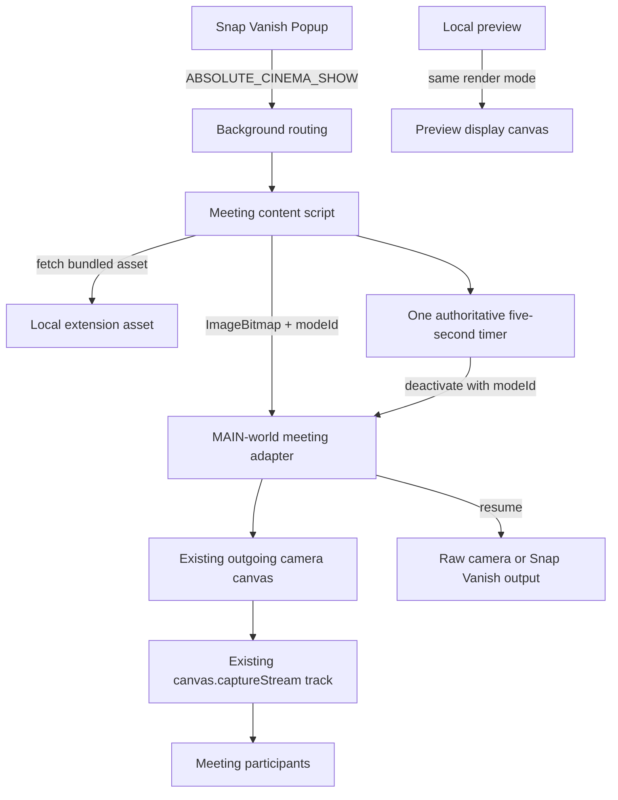

# Snap Vanish — Absolute Cinema Feature Architecture

**Document type:** Implemented feature architecture
**Feature:** Absolute Cinema outgoing-camera render mode
**Parent extension:** Snap Vanish (Chrome Extension, Manifest V3)
**Status:** Implemented; automated render-mode tests pass

---

## 1. Purpose

Absolute Cinema is an independent feature of Snap Vanish.

When the user clicks **Absolute Cinema** in the extension popup, the bundled meme is drawn into the extension's existing outgoing camera canvas for five seconds. Remote meeting participants see the meme because that canvas already supplies the outgoing video track. The normal camera or Snap Vanish output resumes automatically when the cycle ends.

This is a **render mode**, not a webpage overlay. It does not create a second camera stream, replace the outgoing track, or touch the microphone.

## 2. Goals

- Provide a dedicated popup button.
- Render the bundled meme in the existing outgoing camera canvas for five seconds.
- Make the meme visible to remote participants through the existing capture stream.
- Keep the outgoing video track, microphone state and pipeline lifecycle intact.
- Restart cleanly on repeated activation using one timer.
- Reject stale timer callbacks and stale deactivation messages.
- Preserve hard isolation from Snap Vanish gesture detection, segmentation, background reconstruction, particles and audio handling.

## 3. Non-goals

This feature does not:

- Insert a DOM overlay into the meeting page.
- Create or replace a camera track.
- Call `getUserMedia` a second time.
- Mute, unmute or otherwise change microphone state.
- Depend on finger-snap detection.
- Fetch an image or any other resource from the network.
- Change Snap Vanish settings or gesture behavior.

## 4. User flow

1. The user clicks **Absolute Cinema** in the Snap Vanish popup or on the in-meeting overlay.
2. The popup sends `ABSOLUTE_CINEMA_SHOW` through the existing background routing; the overlay invokes the content-script activation path directly.
3. The active meeting content script prepares the bundled image and activates the meeting adapter.
4. The adapter pre-mirrors the meme inside an isolated canvas transform and draws it into the existing outgoing canvas on every frame.
5. The meme remains visible for five seconds.
6. The content script's single authoritative timer expires and deactivates the render mode.
7. The adapter immediately resumes drawing the current camera or Snap Vanish output.

Repeated clicks cancel the previous timer and start a new five-second cycle. No duplicate timers, streams, overlays or tracks are created.

## 5. Architecture



### Components and responsibilities

| Component | Responsibility |
|---|---|
| Popup | Sends the activation request and reports errors. |
| Background | Routes the request only to a supported meeting or preview tab. |
| Content script | Loads the local image, owns the timer, coordinates activation/deactivation, and rejects stale results. |
| Meeting adapter | Stores the active meme bitmap, switches the final canvas draw path, and guards against stale stops. |
| Preview | Uses the same timer/render semantics on its local display canvas. |
| Local asset | `assets/images/CINEMA.jpeg`; loaded from the extension package only. |

## 6. Authoritative timer and stale-callback policy

The content script owns the only display timer:

- Duration: **5,000 ms**.
- The timer starts only after the adapter acknowledges activation, so the five seconds describe actual visible meme time.
- Repeated activation cancels the old timer and starts a new cycle.
- Every activation receives a monotonically increasing `modeId`.
- A stale callback cannot stop a newer cycle because the controller checks its lifecycle token before calling `onStop`.
- Deactivation messages carry the `modeId`; the adapter ignores a stop whose `modeId` is older than its current mode.
- The adapter also stores a deadline derived from the acknowledged activation. This deadline is a safety guard, not a second user-facing timer, and it closes the mode if a deactivation message is ever lost.

## 7. Rendering

The final outgoing render switch is `StreamAdapter.tick()` in `content/meeting-adapter.js`:

- If Absolute Cinema is active and its `ImageBitmap` is ready, the adapter draws only the meme using a contain fit.
- The meme is drawn through an isolated `save()` / `setTransform()` / `translate()` / `scale(-1, 1)` / `restore()` path so it is pre-mirrored for meeting clients that horizontally mirror the outgoing camera image. The transform is scoped to the Absolute Cinema draw and never changes the normal camera or Snap Vanish rendering path.
- Neither the raw camera frame nor a processed Snap Vanish frame is drawn over it.
- The raw and processed paths are otherwise unchanged and resume immediately when the mode ends.
- Frame processing and microphone analysis continue while the meme is active; the mode changes only the final visual composite.
- The existing canvas and capture stream are reused. No track is stopped, replaced or recreated.
- Expired processed frames are still closed on their normal schedule.

The local preview applies the same rule after its normal pipeline draw, so the preview and outgoing feed agree.

## 8. Conflict policy with Snap Vanish

Absolute Cinema must safely coexist with an active Snap Vanish state:

- The meme has visual priority over both the live camera and the processed Snap Vanish output.
- The Snap Vanish state machine continues unchanged. A vanish that starts while the meme is visible still transitions to vanished.
- Microphone handling, mute ownership, audio analysis, segmentation and background reconstruction continue unchanged.
- When the five-second cycle ends, the adapter resumes the **current** Snap Vanish state. It does not reset, cancel or replay the snap animation.
- The preview test exercises this policy by starting a vanish during the meme cycle and verifying that the meme remains visible until expiry, then the vanished frame resumes.

## 9. Message contract

All page messages use the existing `__snapVanish` channel and the content session identifier.

### Activate

```json
{
  "type": "SV_ABSOLUTE_CINEMA",
  "active": true,
  "modeId": 3,
  "requestId": 3,
  "durationMs": 5000,
  "bitmap": "<ImageBitmap>"
}
```

The `ImageBitmap` is transferred from the isolated content script to the MAIN-world adapter. No page-visible extension URL or remote request is required.

### Deactivate

```json
{
  "type": "SV_ABSOLUTE_CINEMA",
  "active": false,
  "modeId": 3
}
```

### Acknowledgment

```json
{
  "type": "SV_ABSOLUTE_CINEMA_RESULT",
  "requestId": 3,
  "modeId": 3,
  "ok": true,
  "active": true,
  "restarted": false,
  "durationMs": 5000
}
```

Failure responses use `ok: false` with a reason such as `no-camera`, `image-unavailable`, `adapter-timeout` or `adapter-not-ready`.

## 10. Error handling

Handle these cases without interrupting Snap Vanish:

- Unsupported active tab: background returns `unsupported-tab`.
- Content script unavailable: background returns `no-content`.
- Adapter still starting: content returns `adapter-not-ready`.
- No live camera adapter: adapter returns `no-camera`.
- Image preparation failure: content returns `image-unavailable`.
- Adapter does not acknowledge: content returns `adapter-timeout` and sends a deactivation.
- Page navigation or extension reload: the page context and adapter are torn down; the adapter deadline bounds any orphaned mode.
- Rapid repeated clicks: the newest activation wins; stale acknowledgments do not start a timer.

## 11. Strict isolation

Absolute Cinema does not change or depend on:

- Finger or hand tracking.
- Snap gesture detection or sensitivity.
- Person segmentation.
- Background reconstruction.
- WebGL particles, shaders or dust effects.
- Camera-track replacement logic.
- Meeting-site adapter behavior.
- Microphone analysis, mute/unmute handling or audio worklets.
- Existing keyboard shortcuts, storage keys or settings.

The only shared surface is the final outgoing-canvas composition and an additive page message type.

## 12. Testing

Automated coverage:

- Unit tests for one-shot expiry, repeated activation restart, cancel/dispose stale guards and manual stop.
- Browser test against a fake Google Meet page that obtains a real fake-media stream, verifies the outgoing canvas shows the meme within pixel tolerance, verifies a repeated activation extends the cycle, and verifies the camera returns after expiry.
- The same browser test verifies the outgoing video track id and microphone track state are unchanged.
- The local preview test verifies the meme appears on `#displayCanvas`, keeps visual priority during a vanish, and restores the vanished frame afterward.
- The browser test verifies the `no-camera` error and unsupported-tab routing.

Useful commands:

```powershell
npm run build
npm run test:unit
npm run test:e2e
npm test
```

Real Google Meet, Teams or Zoom remote visibility must be verified manually with a second participant. Automated fake-media rendering is not a substitute for that check.

## 13. Definition of done

The feature is complete when:

- A separate popup button activates Absolute Cinema.
- The meme is rendered in the existing outgoing camera canvas for five seconds.
- Remote-visible rendering uses the existing capture stream without track replacement.
- Repeated clicks restart the cycle without duplicate timers or streams.
- Stale timer callbacks and stale stop messages cannot restore the camera early or stop a newer cycle.
- Snap Vanish state, microphone behavior and the camera pipeline continue during the meme cycle.
- The adapter resumes the current camera/effect output after expiry.
- Build, unit tests and render-mode browser tests pass.
- Real-meeting visibility is reported as unverified unless a manual meeting test was actually performed.
