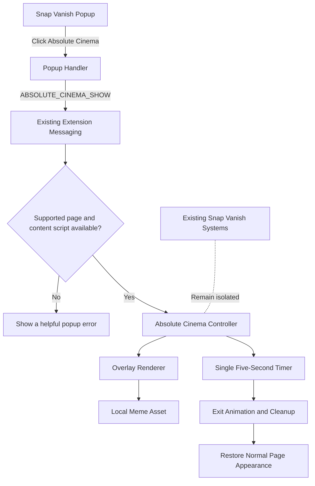
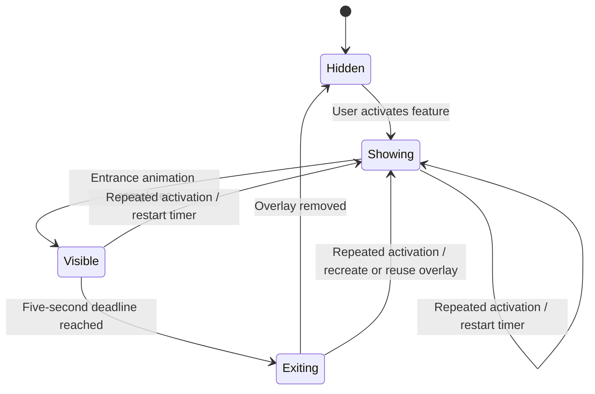

# Snap Vanish — Absolute Cinema Feature Architecture

**Document type:** Feature architecture specification  
**Feature:** Absolute Cinema meme overlay  
**Parent extension:** Snap Vanish (Chrome Extension, Manifest V3)  
**Status:** Proposed design, ready for implementation

---

## 1. Purpose

Add **Absolute Cinema** as an independent feature inside the existing Snap Vanish Chrome extension.

When the user clicks a dedicated **🎬 Absolute Cinema** button in the extension popup, the meme appears as a local overlay on the active webpage for five seconds and then disappears automatically.

The feature is separate from the existing finger-snap disappearance effect.

## 2. Goals

- Provide a dedicated button in the existing extension popup.
- Show a local webpage overlay for five seconds.
- Use a short cinematic entrance and exit animation.
- Support repeated activation without creating duplicate overlays.
- Keep the meme image bundled locally with the extension.
- Clean up the overlay, timers, and event listeners reliably.
- Preserve all existing Snap Vanish functionality.

## 3. Non-goals

This feature will **not**:

- Trigger or depend on finger-snap detection.
- Modify the processed camera feed or outgoing video track.
- Mute, unmute, or otherwise control the microphone.
- Add sound effects, particle effects, or unrelated features.
- Broadcast the meme to meeting participants.
- Require a remote image or runtime network request.

## 4. User flow

1. The user opens the Snap Vanish popup.
2. The user clicks **🎬 Absolute Cinema**.
3. The popup sends a dedicated activation message using the extension's existing messaging mechanism.
4. The active tab's content script validates the request and creates or reuses the overlay.
5. The meme appears with a brief fade-in and subtle zoom.
6. The overlay remains visible for a total display cycle of approximately five seconds, including the exit animation.
7. The overlay fades out and is removed.
8. The page returns to its previous appearance.

If the user clicks the button while the meme is already visible, the current display cycle restarts. There must never be more than one overlay instance per page.

## 5. Architecture



### Components and responsibilities

| Component | Responsibility |
|---|---|
| Existing popup UI | Hosts the new button without replacing existing controls. |
| Popup handler | Sends the activation request and presents errors if delivery fails. |
| Existing messaging layer | Routes the dedicated action to the content script. |
| Absolute Cinema controller | Manages activation state, timer restart, duplicate prevention, and cleanup. |
| Overlay renderer | Creates and removes the visual overlay and applies animations. |
| Local meme asset | Supplies the image without runtime network access. |

Reuse existing components where possible. These are logical responsibilities; they do not mandate creating every component as a separate file.

## 6. Suggested file layout

Adapt this layout to the repository after inspecting its actual structure. Do not create duplicate popup or messaging infrastructure if it already exists.

```text
snap-vanish/
├── popup/
│   ├── popup.html                 # Existing popup; add the new button
│   ├── popup.css                  # Existing styles; add isolated button styles
│   └── popup.js                   # Existing handler; send activation message
├── content/
│   ├── content-src.js             # Existing content entry/bundle
│   └── absolute-cinema/
│       ├── controller.js          # Activation and timer lifecycle
│       ├── overlay.js              # Overlay creation and removal
│       └── absolute-cinema.css    # Isolated visual styles
├── assets/
│   └── images/
│       └── absolute-cinema.webp   # Bundled local meme image
├── background.js                 # Reuse only if current routing requires it
├── manifest.json                 # Change only if genuinely required
└── ...existing files
```

If the current project bundles content scripts, import the new modules into the existing entry point and use the existing build process. Do not rely on unsupported runtime imports.

## 7. Message contract

Use the project's current message conventions. The following is a conceptual contract, not a requirement to replace the existing protocol.

### Request

```json
{
  "action": "ABSOLUTE_CINEMA_SHOW"
}
```

### Expected behavior

- Accept the action only through the extension's existing trusted message flow.
- Validate the message shape.
- Invoke the Absolute Cinema controller.
- Return a success or failure response if the existing messaging pattern supports responses.
- Handle missing content scripts, unsupported tabs, and navigation races gracefully.

Do not add a new service worker if the existing background service worker can route the action safely. Avoid new permissions unless a demonstrated requirement exists.

## 8. Overlay behavior and timing

### Lifecycle



### Timing rules

- Target display duration: **5,000 milliseconds** from activation to the start of cleanup, with the exit animation included in the five-second cycle.
- Use one authoritative timer per page.
- Repeated activation restarts the timer instead of creating a second overlay.
- Prevent stale timer callbacks from removing a newly activated overlay. A lifecycle token or equivalent guard may be used.
- Use a short entrance animation and a short exit animation.
- Use a bounded cleanup fallback so an animation event that never fires cannot leave the overlay behind.
- On page navigation or document teardown, allow the browser to discard the overlay and ensure no persistent background resources are created.

## 9. Visual and accessibility requirements

- Display the meme prominently but keep the design restrained.
- Use a short fade-in, slight zoom, and fade-out.
- Use local CSS and a local image asset.
- Prefer a Shadow DOM root if compatible with the existing codebase, to prevent webpage styles from changing the overlay.
- Use a high stacking order without modifying the host page's layout.
- Do not intercept pointer events unnecessarily; the overlay should not block page controls.
- Respect reduced-motion preferences where practical.
- Ensure the image has appropriate alternative text if represented as an image element.
- Avoid injecting global CSS into the host page.

## 10. Strict isolation from existing Snap Vanish

Absolute Cinema must not change or depend on:

- Finger or hand tracking.
- Snap gesture detection or sensitivity settings.
- Person segmentation.
- Background reconstruction.
- WebGL particles, shaders, or dust effects.
- Camera-track replacement or restoration.
- Google Meet, Microsoft Teams, or Zoom meeting adapters.
- Microphone analysis, mute/unmute logic, or audio worklets.
- Existing keyboard shortcuts or settings.
- Existing feature state or message contracts, except for the additive activation action.

The overlay must be a **DOM-based local webpage overlay**, never a layer in the processed camera canvas.

Prefer additive changes. If a shared file must be modified, make the smallest possible change and document the reason.

## 11. Error handling

Handle these cases gracefully:

- The active tab is a browser-internal page or otherwise cannot host a content script.
- The content script is not loaded or cannot receive messages.
- The local image asset is missing or fails to load.
- The user clicks repeatedly.
- The page navigates or closes while the overlay is visible.
- The extension is reloaded during development.

A failed Absolute Cinema activation must not interrupt Snap Vanish or other extension controls.

## 12. Testing plan

### Feature tests

- [ ] Popup contains a distinct Absolute Cinema button.
- [ ] Clicking the button displays exactly one overlay.
- [ ] Overlay uses the bundled local image.
- [ ] Display cycle lasts approximately five seconds, including exit animation.
- [ ] Overlay disappears automatically.
- [ ] Repeated clicks restart the timer.
- [ ] No duplicate overlays or stale timers are left behind.
- [ ] Unsupported tabs show a useful error.
- [ ] No network request is needed to display the meme.
- [ ] Navigation removes the old page's overlay naturally and leaves no persistent resources.

### Regression tests

- [ ] Snap detection still works.
- [ ] Existing disappearance and restoration effects still work.
- [ ] Camera-track processing is unchanged.
- [ ] Microphone controls are unchanged.
- [ ] Existing settings and shortcuts still work.
- [ ] Supported meeting adapters retain their existing behavior.

Run the current build, lint, and test commands. Test in a real browser where available. Do not claim a real meeting test unless one was actually performed.

## 13. Implementation sequence

1. Audit the current repository and identify the existing popup, content entry point, messaging protocol, and build process.
2. Implement the isolated overlay renderer and controller.
3. Add the popup button and activation message.
4. Bundle the local meme asset and new modules through the existing build process.
5. Add focused tests for timer behavior, repeat activation, cleanup, and unsupported tabs.
6. Run the build and regression checks.
7. Report all added and modified files and any unverified behavior.

## 14. Definition of done

The feature is complete when:

- A separate popup button activates Absolute Cinema.
- The meme appears locally on the active webpage and disappears after a five-second cycle.
- Repeated clicks restart the cycle without duplicating overlays.
- Timers and DOM resources are cleaned up.
- No camera or microphone behavior changes.
- Existing Snap Vanish features pass the available regression checks.
- Build and test outcomes are reported accurately.
